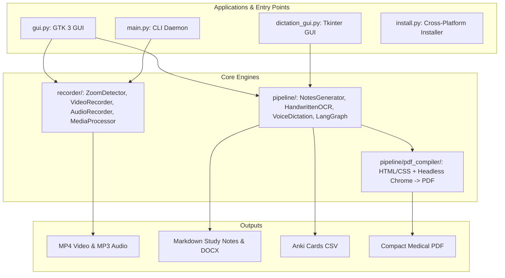

# OmniLecture Studio

Automated Screen & Audio Recording, Voice Dictation, Handwritten Notes OCR, and AI Study Notes Generator with High-Density PDF Compilation.

Designed for medical and technical students, researchers, and professionals on **Linux (GNOME/Wayland)** and **macOS**.

---

## 🎯 Features & Overview

1. **High-Efficiency Screen & Audio Recorder (`recorder/`)**:
   * **Automatic Zoom Daemon**: Polls active windows silently; initiates recording when a Zoom call begins, automatically mixing speaker audio and optional microphone.
   * **Manual Recording**: Immediate full-screen or monitor-targeted screen capture.
   * **Optimized H.264 & AAC Encoding**: Tuned FFmpeg compression (10 FPS, CRF 24, stillimage tune) ensuring crystal-clear presentation slides while reducing file size by up to 70%. Also outputs companion MP3 tracks.
   * **Cross-Platform Audio**: Native GStreamer pipeline on Linux; `sounddevice` / CoreAudio streaming on macOS.

2. **EIR Study Notes & Anki Cards Pipeline (`pipeline/`)**:
   * **Multimodal Extraction**: Video slide OCR via Tesseract with automatic webinar chat cropping, paired with Whisper audio transcription (`faster-whisper` local or remote API).
   * **LangGraph State Machine**: Sequential 30-minute chunk processing (Consolidation -> Segmentation -> Parallel Generation of Markdown Notes & Anki CSV Flashcards).
   * **Strict Anti-Hallucination**: Verifies clinical scales and prevents fabricated nursing codes.

3. **Handwritten Notes Digitization (`pipeline/handwritten_notes.py`)**:
   * **Photographic Enhancement**: OpenCV CLAHE adaptive contrast equalization and grayscale filtering on paper notes.
   * **Zero-Invention Policy**: Translates handwritten schemas into Mermaid diagrams, Markdown comparison tables, and LaTeX mathematical formulas without inferring unstated facts.

4. **Student Voice Dictation (`pipeline/dictation_notes.py`)**:
   * **Audio Cleanup**: FFT bandpass denoiser (`afftdn`) and pause removal (`silenceremove`).
   * **Ultra-Light MP3 & Docx Export**: Mono 32 kbps backup audio with automated export to Microsoft Word (`.docx`).

5. **Medical-Grade PDF Compiler (`pipeline/pdf_compiler/`)**:
   * Generates compact, multi-column print-ready A4 PDFs from Markdown notes via custom dynamic CSS and headless Chrome.

---

## 🏗️ Architecture & Package Layout



### 📂 Directory Organization

```
omnilecture-studio/
├── pyproject.toml              # PEP 621 packaging, CLI entrypoints, and pytest configuration
├── requirements.txt            # Unified core & feature dependencies
├── requirements-dev.txt        # Development and testing tools
├── config.py                   # Centralized configuration and environment loader
├── pipeline_config.py.example  # Safe template for LLM credentials and endpoints
├── main.py                     # CLI recording daemon entry point
├── gui.py                      # GTK 3 desktop GUI entry point (Linux)
├── dictation_gui.py            # Tkinter dictation GUI entry point (macOS)
├── install.py                  # Cross-platform installer (Linux & macOS)
│
├── recorder/                   # Screen, audio, and Zoom detection/processing engine
│   ├── detector.py             # Active Zoom meeting window detector
│   ├── display_manager.py      # Multi-monitor geometry and boundary mapper
│   ├── video_recorder.py       # GNOME Screencast D-Bus video recorder
│   ├── audio_recorder.py       # Modular audio engine (GStreamer & sounddevice strategies)
│   └── processor.py            # FFmpeg audio/video merger, compressor, and duration prober
│
├── pipeline/                   # Multimodal AI transcription and notes generator
│   ├── generate_notes.py       # Main class video orchestrator with LangGraph
│   ├── transcription.py        # Remote Whisper API & local faster-whisper transcriber
│   ├── ocr.py                  # Video slide OCR extractor with chat crop filter
│   ├── graph.py                # LangGraph state machine (Consolidate, Segment, Notes, Anki)
│   ├── handwritten_notes.py    # Digitizer for photographed handwritten notes
│   ├── dictation_notes.py      # Student voice dictation notes orchestrator
│   ├── dictation_service.py    # Multi-mode dictation service (CLI, GUI, HTTP daemon)
│   ├── dictation_chunker.py    # Anti-OOM audio chunker
│   ├── dictation_preprocessor.py # Phonetic normalizer and spoken punctuation cleaner
│   ├── docx_exporter.py        # Markdown to Microsoft Word (.docx) converter
│   ├── llm_manager.py          # Unified OpenAI-compatible LLM client
│   ├── prompts.py              # Centralized prompt templates
│   └── pdf_compiler/           # Headless Chrome PDF compiler engine
│
├── gui_components/             # Modular GTK 3 tabs and dialogs
│   ├── recorder_tab.py         # Screen and Zoom recording tab
│   ├── eir_notes_tab.py        # Video notes and Anki flashcards tab
│   ├── handwritten_tab.py      # Handwritten photo notes tab
│   ├── dictation_tab.py        # Voice dictation tab
│   ├── pdf_compiler_tab.py     # PDF compiler tab
│   └── dialogs.py              # Modal alert and confirmation dialogs
│
├── scripts/                    # Reusable standalone CLI tools
│   ├── compress_video.py       # General FFmpeg video compressor (MP4 + MP3)
│   └── recover.py              # Recovery utility for interrupted recording sessions
│
└── tests/                      # Hermetic unit and integration test suite
    ├── conftest.py             # System shims (PyGObject, D-Bus, Vision, Audio)
    ├── test_recorder.py
    ├── test_display_manager.py
    ├── test_dictation_pipeline.py
    ├── test_dictation_service.py
    ├── test_docx_exporter.py
    ├── test_gui_components.py
    ├── test_handwritten_pipeline.py
    ├── test_pdf_compiler.py
    └── test_pipeline.py
```

---

## ⚡ Quick Start & Installation

### 1. System Dependencies

* **Linux (Debian / Ubuntu / Zorin OS)**:
  ```bash
  sudo apt update && sudo apt install ffmpeg tesseract-ocr tesseract-ocr-spa x11-utils python3-gi python3-dbus
  ```
* **macOS**:
  ```bash
  brew install ffmpeg tesseract tesseract-lang
  ```

### 2. Python Environment & Installation

```bash
# Clone the repository
git clone https://github.com/your-username/omnilecture-studio.git
cd omnilecture-studio

# Create virtual environment
python3 -m venv .venv
source .venv/bin/activate

# Unified installation via pip
pip install -r requirements.txt

# Or modern editable install with all optional packages
pip install -e ".[all]"
```

### 3. Automated System Installer

Run the unified cross-platform installer to configure desktop launchers, application menu entries, and CLI commands:

```bash
python3 install.py
```

---

## 🚀 Usage

### Graphical Interfaces (GUI)

* **Linux (GTK 3 GUI)**:
  ```bash
  python3 gui.py
  # Or via CLI alias:
  omnilecture
  ```
* **macOS (Native Dictation GUI)**:
  ```bash
  python3 dictation_gui.py
  # Or double-click "Dictado EIR.command" on Desktop
  ```

### Command Line Tools (CLI)

```bash
# Start background Zoom recorder daemon
omnilecture-cli --auto

# Immediate manual screen recording
omnilecture-cli --manual

# Generate study notes and Anki flashcards from class video
python3 -m pipeline.generate_notes --video /path/to/class.mp4

# Digitize handwritten note photos
python3 -m pipeline.handwritten_notes --images page1.jpg page2.jpg

# Interactive student voice dictation
omnilecture-dictation --record

# Compress any video file (10 FPS H.264 + standalone MP3)
omnilecture-compress /path/to/input.mp4 -o /path/to/compressed.mp4

# Recover interrupted temporary recordings
omnilecture-recover
```

---

## ⚙️ Configuration

1. **General Recorder Settings (`config.py`)**:
   Adjust default directories, recording framerate, CRF quality factor, and microphone mixing.
2. **AI & Pipeline Credentials (`pipeline_config.py`)**:
   Copy the template and fill in your credentials:
   ```bash
   cp pipeline_config.py.example pipeline_config.py
   ```
   Alternatively, set environment variables:
   * `OMNILECTURE_API_KEY`: OpenAI-compatible API key.
   * `OMNILECTURE_API_BASE_URL`: Base URL (default: `https://leria.gal/api`).
   * `OMNILECTURE_MODEL_NAME`: Model identifier (default: `leria:redacta`).
   * `OMNILECTURE_USE_REMOTE_WHISPER`: `true` or `false`.

---

## 🧪 Testing & Quality Assurance

Run the entire test suite using `pytest`:

```bash
# Run all unit tests
pytest tests/

# Run tests with coverage
pytest tests/ --cov=.
```

Verify style and security guidelines:

```bash
# PEP 8 linting
flake8 . --exclude=.venv,.temp,__pycache__,recorder/__pycache__,pipeline/__pycache__ --max-line-length=120

# Static security audit
bandit -r . -x ./.venv,./.temp,./__pycache__,recorder/__pycache__,pipeline/__pycache__ -ll
```

---

## 📄 License

This project is licensed under the [MIT License](LICENSE).
