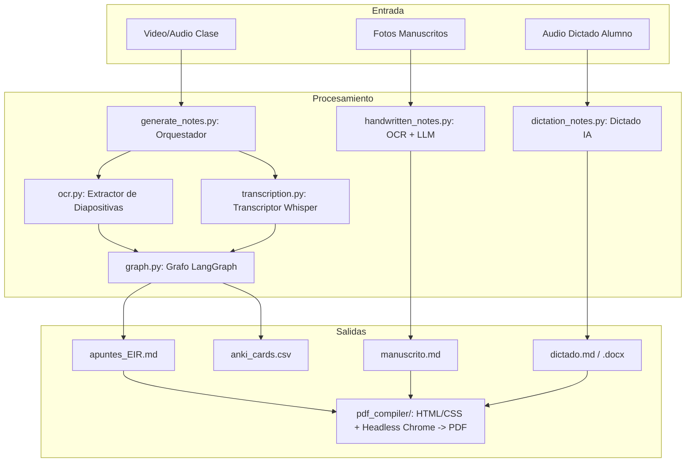

# Resumen de Arquitectura: Pipelines de Apuntes, Transcripción y Compilación

Este documento detalla las implementaciones, optimizaciones de arquitectura y configuraciones realizadas en la herramienta de automatización para generar apuntes estructurados, tarjetas Anki, digitalización de manuscritos, dictado por voz y compilación a PDF.

---

## 1. 🛠️ Preparación y Dependencias del Entorno

### Dependencias del Sistema
* **Motor OCR**: `tesseract-ocr` junto con los paquetes de idioma (`tesseract-ocr-spa`, `tesseract-ocr-eng`) para procesar diapositivas y notas manuscritas.
* **Procesamiento Multimedia**: `ffmpeg` para recodificación, compresión H.264, recorte de audio anti-OOM y filtros de reducción de ruido FFT.
* **Captura de Pantalla y Audio**: PyGObject (GTK 3, GStreamer) en Linux y CoreAudio / `sounddevice` en macOS.

### Entorno Virtual (`.venv`) y Empaquetado
* Instalación unificada y declarativa mediante **`pyproject.toml`** y **`requirements.txt`**.
* Librerías de IA y orquestación: `langgraph`, `langchain`, `langchain-openai`, `faster-whisper`.
* Compilación y renderizado: `markdown-it-py`, `pydantic`, `python-docx`.

---

## 2. 🏗️ Arquitectura de Código de las Pipelines

### 📄 Descripción de Módulos

1. **[ocr.py](ocr.py)**:
   * **Extracción de Diapositivas**: Captura fotogramas del vídeo usando OpenCV con tolerancia si no está instalado.
   * **Filtrado Horizontal (Crop)**: Recorta automáticamente el 25% derecho para excluir chat de Zoom o controles.
   * **Salto Rápido (Seek)**: Optimiza la lectura de fotogramas saltando directamente a los intervalos de muestreo (15s).
   * **Detección de Cambio por Miniaturas**: Compara miniaturas de 16x16 píxeles para evitar llamadas redundantes a Tesseract.

2. **[transcription.py](transcription.py)**:
   * **Procesador Whisper**: Transcripción local vía `faster-whisper` (int8) o remota a través del endpoint Leria Whisper API.
   * **Estrategia Anti-OOM**: Fragmenta audios extensos en tramos secuenciales de 30 minutos sin re-codificación, manteniendo el consumo de RAM inferior a 1 GB.

3. **[prompts.py](prompts.py)**:
   * Módulo centralizado de plantillas de prompts para consolidación, segmentación, apuntes, tarjetas Anki y dictados.
   * **Filtro Anti-Alucinaciones**: Prohibición explícita de inventar datos clínicos, códigos NANDA o escalas no mencionadas.

4. **[graph.py](graph.py)**:
   * Máquina de estados LangGraph que orquesta en paralelo la redacción de apuntes Markdown y las tarjetas de memoria Anki CSV.

5. **[generate_notes.py](generate_notes.py)**:
   * Orquestador para clases completas en vídeo. Aplica deduplicación, partición en ventanas temporales y paso final de refinamiento editorial.

6. **[handwritten_notes.py](handwritten_notes.py)**:
   * Digitalizador de fotografías manuscritas con ecualización de contraste CLAHE, Tesseract y conversión a Markdown sin invención de contenido.

7. **[dictation_notes.py](dictation_notes.py)** y **[dictation_service.py](dictation_service.py)**:
   * Pipeline de dictado por voz para estudiantes: filtros de ruido acústico FFT, eliminación de silencios, codificación MP3 ultra-ligera (32 kbps mono) y estructuración a Markdown y DOCX.

8. **[pdf_compiler/](pdf_compiler/)**:
   * Compilador de documentos Markdown a PDF médico de alta densidad tipográfica mediante motor CSS adaptativo y Chromium/Chrome headless.

---

## 3. ⚙️ Seguridad y Configuración

* **[config.py](../config.py)**: Configuración centralizada de rutas del sistema, parámetros FFMPEG y resolución segura de credenciales.
* **[pipeline_config.py.example](../pipeline_config.py.example)**: Plantilla segura para credenciales de API (`API_BASE_URL`, `API_KEY`, `MODEL_NAME`).
* **[.gitignore](../.gitignore)**: Exclusión estricta de credenciales locales (`pipeline_config.py`, `.env`), entornos virtuales (`.venv`) y artefactos compilados.

---

## 4. 🧪 Validación y Pruebas Unitarias

La suite de pruebas se localiza en **[`tests/`](../tests/)** y cubre todos los módulos con mocks rápidos y reproducibles:
* `test_recorder.py`: Detector de reuniones Zoom, grabador de vídeo y procesador FFmpeg.
* `test_display_manager.py`: Detección geométrica de monitores y ventanas.
* `test_dictation_pipeline.py` & `test_dictation_service.py`: Transcripción de dictado, pausas y formatos.
* `test_docx_exporter.py`: Exportación a Microsoft Word.
* `test_gui_components.py`: Componentes modulares de interfaz gráfica GTK.
* `test_handwritten_pipeline.py`: OCR de apuntes manuscritos y HEIC.
* `test_pdf_compiler.py`: Estrategias de maquetación, CSS y compilación PDF.
